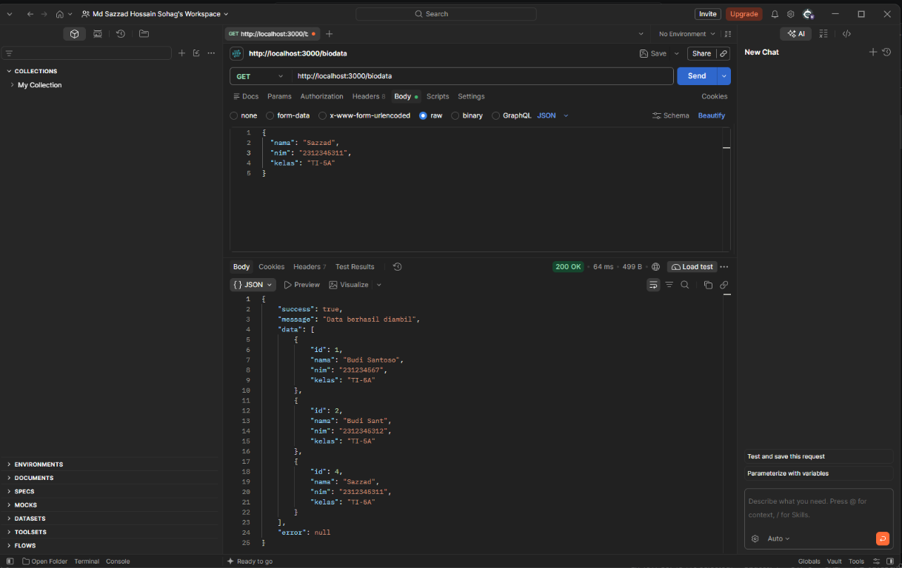
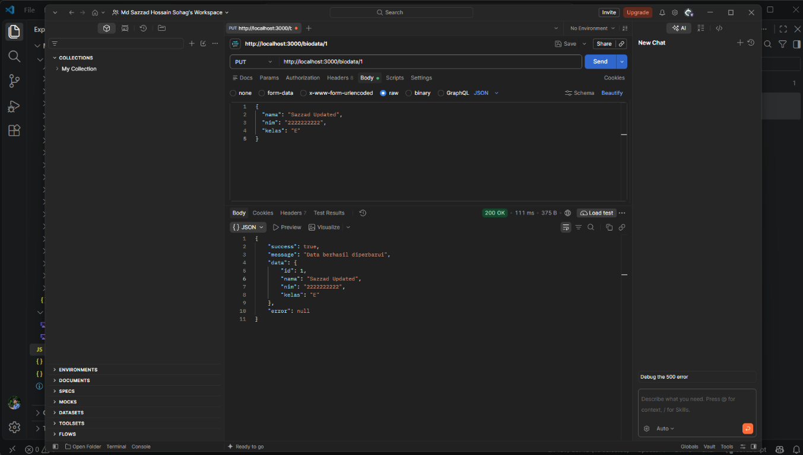
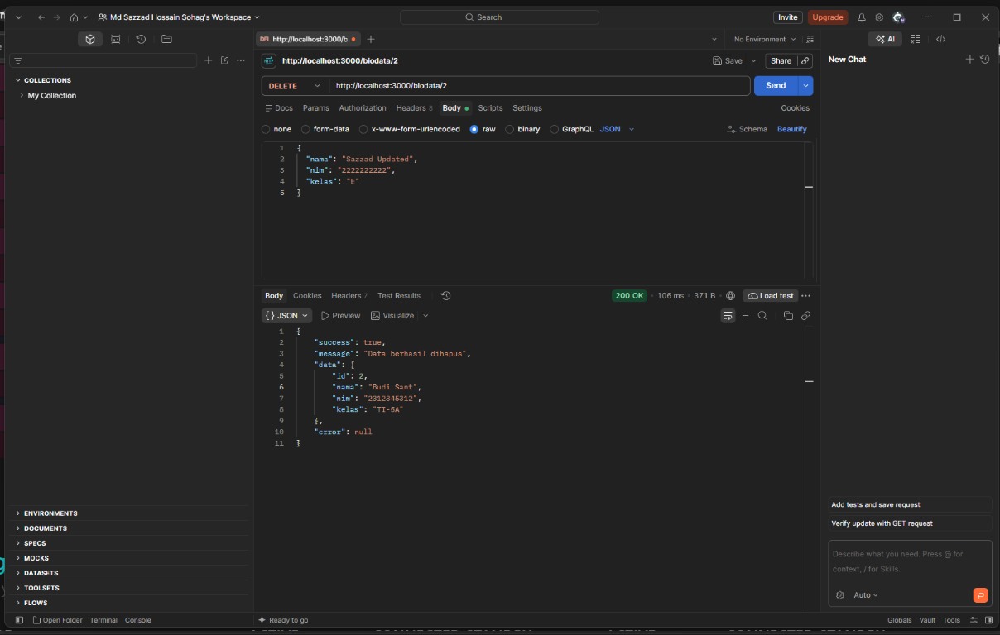

# Biodata CRUD API

Express.js REST API untuk mengelola data biodata mahasiswa menggunakan PostgreSQL, middleware, validasi Joi, dan error handling.

## Teknologi

- Node.js
- Express.js
- PostgreSQL
- Joi
- Postman

## Struktur data

Database: `mahasiswa`

Tabel: `biodata`

| Kolom | Tipe | Keterangan |
|---|---|---|
| `id` | Integer | Primary key, dibuat otomatis |
| `nama` | Varchar(100) | Wajib diisi |
| `nim` | Varchar(20) | Wajib diisi |
| `kelas` | Varchar(10) | Wajib diisi |

## Persiapan PostgreSQL

Buat database terlebih dahulu:

```sql
CREATE DATABASE mahasiswa;
```

Kemudian pilih database `mahasiswa` dan buat tabel:

```sql
CREATE TABLE IF NOT EXISTS biodata (
    id INTEGER GENERATED BY DEFAULT AS IDENTITY PRIMARY KEY,
    nama VARCHAR(100) NOT NULL,
    nim VARCHAR(20) NOT NULL,
    kelas VARCHAR(10) NOT NULL
);
```

## Instalasi dan menjalankan aplikasi

```powershell
npm install
node .\index.js
```

Server berjalan di:

```text
http://localhost:3000
```

Konfigurasi PostgreSQL default:

```text
User     : postgres
Host     : localhost
Database : mahasiswa
Password : 1234
Port     : 5432
```

Jika password PostgreSQL berbeda, atur environment variable sebelum menjalankan server:

```powershell
$env:PGPASSWORD="password_postgresql_anda"
node .\index.js
```

## Middleware dan error handling

API menggunakan:

- `express.json()` untuk membaca request JSON.
- Middleware logging untuk mencatat method, URL, status, dan durasi request.
- Middleware Joi untuk validasi body dan parameter `id`.
- Parameterized query PostgreSQL untuk query yang aman.
- Error handler terpusat dengan response JSON yang konsisten.

## Dokumentasi endpoint

Base URL:

```text
http://localhost:3000
```

### GET semua biodata

```http
GET /biodata
```

Contoh response:

```json
{
  "success": true,
  "message": "Data berhasil diambil",
  "data": [
    {
      "id": 1,
      "nama": "Budi Santoso",
      "nim": "231234567",
      "kelas": "TI-5A"
    }
  ],
  "error": null
}
```

Endpoint root `GET /` juga mengembalikan daftar biodata.

### GET biodata berdasarkan ID

```http
GET /biodata/1
```

### POST menambahkan biodata

```http
POST /biodata
Content-Type: application/json
```

Body:

```json
{
  "nama": "Budi Santoso",
  "nim": "231234567",
  "kelas": "TI-5A"
}
```

Response berhasil menggunakan status `201 Created`.

### PUT memperbarui biodata

```http
PUT /biodata/1
Content-Type: application/json
```

Body:

```json
{
  "nama": "Budi Santoso Updated",
  "nim": "231234567",
  "kelas": "TI-5B"
}
```

`id` dikirim melalui URL dan tidak perlu dimasukkan ke body.

### DELETE menghapus biodata

```http
DELETE /biodata/1
```

Request ini tidak membutuhkan body.

## Urutan pengujian di Postman

1. `GET http://localhost:3000/biodata`
2. `POST http://localhost:3000/biodata`
3. Simpan `id` dari response POST.
4. `GET http://localhost:3000/biodata/{id}`
5. `PUT http://localhost:3000/biodata/{id}`
6. `DELETE http://localhost:3000/biodata/{id}`
7. Jalankan GET kembali untuk memastikan data sudah terhapus.

Untuk request POST dan PUT, pilih **Body → raw → JSON** dan gunakan header:

```text
Content-Type: application/json
```

## Contoh validasi

Body berikut akan ditolak karena `nama`, `nim`, dan `kelas` tidak memenuhi aturan:

```json
{
  "nama": "A",
  "nim": "12",
  "kelas": ""
}
```

Response validasi menggunakan status `400 Bad Request`.

## Screenshot hasil pengujian

### POST biodata berhasil


### GET semua biodata berhasil



### PUT biodata berhasil

Untuk request PUT, gunakan **Body → raw → JSON**. Jangan masukkan `id` ke dalam body karena ID dikirim melalui URL.

```json
{
  "nama": "Sazzad Updated",
  "nim": "2222222222",
  "kelas": "E"
}
```



### DELETE biodata berhasil

Untuk request DELETE, masukkan ID pada URL dan pilih **Body → none** karena request ini tidak membutuhkan body.

```http
DELETE http://localhost:3000/biodata/2
```


